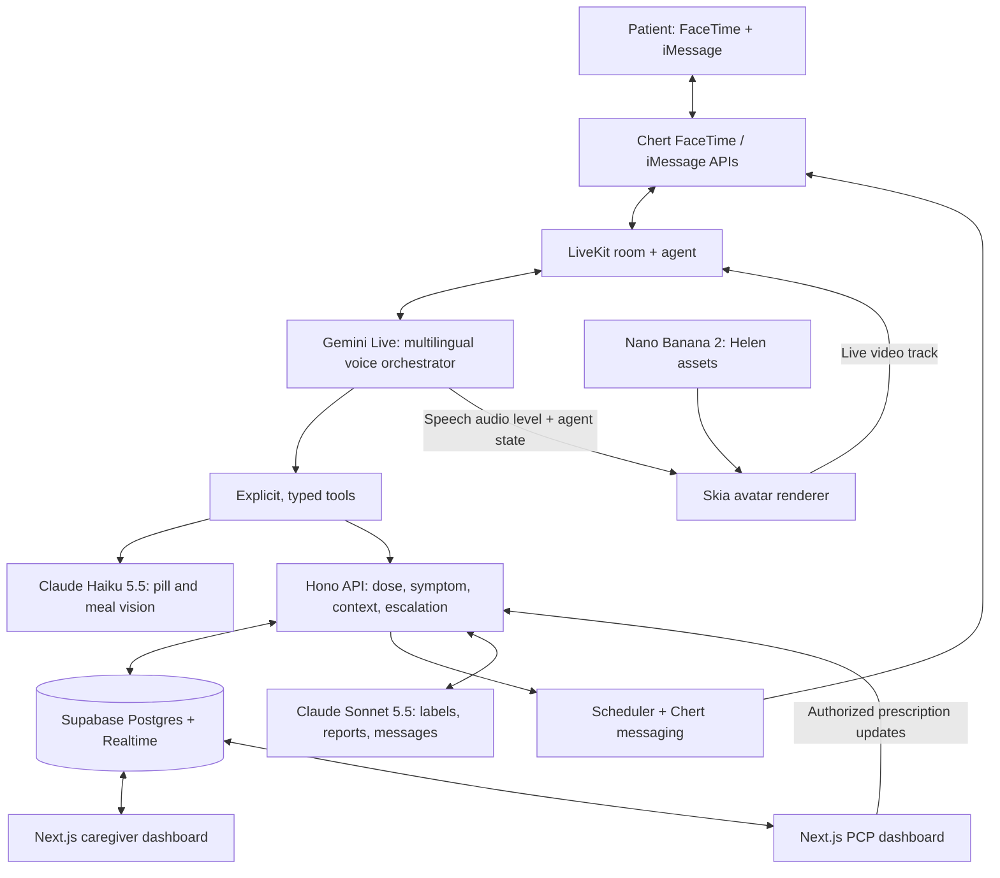

# PillPal 

**A multilingual, multi-agent medication companion on FaceTime and iMessage, with camera-based pill and meal checks and a live connection between patients, caregivers, and primary care providers.**

Built at **HackUTA 2026** for the **Chert Best Use of FaceTime** and **MLH Best Use of Gemini API** challenges.

<p align="center">
  
</p>

## Why we built it

Meet Rose: she's 82, takes several medications each day, and lives hours away from her daughter. A new app is a barrier, but FaceTime and iMessage are familiar. We built PillPal around that difference.

Medication adherence involves more than remembering a time. A patient may be unsure which pill they picked up, whether they've already taken a dose, or whether their meal conflicts with their prescription instructions. A caregiver wants timely information, and a doctor needs a useful picture of what happens between visits.

PillPal connects those three people through a conversation that starts on the patient's phone.

> **HackUTA's Odyssey theme:** Our on-screen companion is **Helen**, inspired by Helen of Sparta in *The Odyssey* (Book 4). We used her role as a welcoming host to shape a calm, approachable character for medication check-ins. Her visual assets were created with **Google Nano Banana 2** and animated for real-time FaceTime calls.

## The experience

| Patient | Caregiver | Primary care provider (PCP) |
| --- | --- | --- |
| Receives a FaceTime call or iMessage reminder in their preferred language | Sees a live weekly pillbox, adherence events, check-ins, and alerts | Sees medication history, trends, and AI-generated weekly briefs |
| Shows a pill or meal to the FaceTime camera for a guided check | Gets notified about concerns and can join an escalation group call | Can update prescriptions and instructions from an authorized doctor account |
| Confirms a reminder with an iMessage heart reaction | Sees medication confirmations appear in the dashboard | Changes sync into the patient's schedule and multilingual notifications |

### 1. Multi-agent medication check-ins

**Google Gemini Live** is Pal's conversational voice agent. It speaks naturally, handles interruptions and language switches, and calls explicit tools when the patient needs something checked or recorded. Specialized AI services handle vision, prescription-label reading, translation, and clinical summaries. The patient experiences one continuous conversation.

### 2. FaceTime computer vision for pills and food

Patients can hold a medication or meal up to the camera. A fresh video frame is extracted and passed to a **Claude Haiku 5.5** vision workflow, which compares the image against the stored medication details or food rules. Pal explains the result in the patient's language.

If the camera is unavailable, the image is unclear, or the vision confidence is too low, Pal asks for more information (such as reading a label) instead of guessing. **An image match is not definitive pill identification.**

### 3. Multilingual FaceTime and iMessage

Pal supports conversations in the patient's preferred language, including mid-call switching (demonstrated in English and Spanish). Reminders, prescription-change notices, and supported voice notes can be translated for the patient; the care team can review English-language summaries and translated quotes.

**iMessage is part of the medication workflow:** the scheduler sends a reminder, an incoming heart reaction can confirm the dose, and the same event updates the dashboards. When a reminder is unanswered, the scheduler can initiate a follow-up FaceTime call. The shared-line transport also supports a reply-based confirmation fallback.

### 4. Three-way connected care

The patient uses FaceTime and iMessage while caregivers and PCPs use **separate, role-aware web dashboards**. **Supabase Realtime** propagates dose confirmations, calls, check-ins, medication changes, and alerts to the relevant care-team views. An authorized doctor can change a prescription; that update flows back into the medication schedule and can trigger a translated patient notification.

### 5. Escalation with a real person

When the patient reports an emergency or asks for their caregiver, Pal records a red alert and notifies the caregiver. The calling service attempts to end the current one-to-one session and initiate a **group FaceTime call** with the patient and caregiver. If group calling fails, the caregiver receives a text fallback. **PillPal does not call 911 on its own.**

### 6. Helen, the FaceTime avatar

Helen's expression assets were generated using **Google Nano Banana 2**. A **Skia Canvas** pipeline turns them into a video track: Helen blinks, reacts to tools and conversation states, and moves her mouth according to the actual audio level of Gemini's speech. The avatar is published by the LiveKit agent into the same room as its audio, then bridged to FaceTime through Chert.

## Architecture



**The division of work matters:** Gemini controls the live dialogue and tool use; Claude processes bounded visual and structured-data tasks; deterministic TypeScript code enforces permissions, recording, confidence handling, and escalation behavior. Nano Banana 2 supplied Helen's generated imagery, while the runtime animation is rendered locally.

### The tech stack

| Layer | Technologies |
| --- | --- |
| Live conversational AI | **Google Gemini Live**, LiveKit Agents, LiveKit RTC |
| Avatar imagery and animation | **Google Nano Banana 2**, Skia Canvas (`@napi-rs/canvas`), Sharp |
| Vision and structured AI tasks | **Claude Haiku 5.5**, **Claude Sonnet 5.5**, Anthropic SDK, Zod |
| Calls and messages | **Chert FaceTime API**, **Chert iMessage API** |
| Backend and job scheduling | TypeScript, Node.js 22+, Hono, node-cron |
| Database and synchronization | Supabase, PostgreSQL, Supabase Realtime, Supabase Auth |
| Caregiver and PCP portals | Next.js, React, Tailwind CSS, Recharts |
| Development and checks | npm workspaces, TypeScript project builds, Node test runner, Claude Code |

## Judge demo: follow one medication from phone to care team

The demo uses a fictional patient and seeded medication data. Live calls require a configured Chert line and verified recipients.

1. **Start at the caregiver dashboard.** Show the patient's scheduled medication and the current weekly pillbox state.
2. **Place a FaceTime check-in.** The patient answers and meets Helen, speaking with Gemini Live in their preferred language.
3. **Show a meal and a medication.** Pal calls the vision tools and responds to their structured results. Demonstrate the uncertainty fallback when a frame is insufficient.
4. **Confirm a dose.** The event is saved, and the caregiver's live pillbox reflects it. Switch the conversation to Spanish to show multilingual support.
5. **Send an iMessage reminder.** Use a heart reaction (or the supported shared-line reply flow) and show the corresponding dose update.
6. **Open the PCP dashboard.** Show the weekly brief and an authorized prescription update feeding back into the patient workflow.
7. **Trigger caregiver escalation.** Show the alert, caregiver message, and attempted group FaceTime connection; the text fallback is used if the line is unavailable.

The standout sequence for Chert is **fresh FaceTime video in both directions**: the patient shows the pill and plate, and Helen appears on the call. The standout sequence for Gemini is **a continuous multilingual voice session that coordinates tools and produces observable changes outside the conversation**.

## Repository map

```text
PillPal/
├── agent/            # Gemini Live voice agent, vision-frame capture, Helen renderer
├── api/              # Hono API, Chert calls/iMessage, scheduler, escalation
├── packages/
│   ├── ai/           # Claude/Gemini helper functions and structured outputs
│   └── shared/       # Shared Zod schemas and API/data types
├── web/              # Next.js caregiver and PCP portal
├── supabase/         # SQL schema, seed data, account/care-team policies
├── docs/             # Contracts and technical design notes
├── .env.example      # Configuration key names; no credentials
└── README.md
```

The technical design documents include proposals and historical notes; they are **not** a promise that every proposed feature is already shipped.

## Run locally

> This is a hackathon prototype with external service dependencies. The dashboard can be explored with mock data, but the end-to-end FaceTime/iMessage flow requires working Chert, LiveKit, AI provider, and Supabase credentials. **Do not commit real keys or use real patient data for demos.**

**Prerequisites:** Node.js **22+**, npm, a Supabase project, a LiveKit project, Google Gemini and Anthropic API access, and Chert FaceTime/iMessage credentials for the live communication workflows.

1. Install dependencies and create your environment file:

   ```bash
   npm install
   cp .env.example .env
   ```

2. Fill in the required values in `.env`: `GOOGLE_API_KEY`, `ANTHROPIC_API_KEY`, `LIVEKIT_*`, `SUPABASE_*`, `CHERT_*`, `API_URL`, and the relevant demo patient/phone values. For a local Next.js server on port 3000, set `WEB_ORIGIN=http://localhost:3000` and `NEXT_PUBLIC_API_URL=http://localhost:8787`. See [`.env.example`](.env.example) and the [API setup guide](api/README.md) for transport modes and required services.

3. Apply [`supabase/schema.sql`](supabase/schema.sql), [`supabase/002_accounts.sql`](supabase/002_accounts.sql), and optionally [`supabase/seed.sql`](supabase/seed.sql) in your Supabase project, following the account setup described in [`web/README.md`](web/README.md). Use fictional demo data.

4. Run the API and web portal in separate terminals:

   ```bash
   npm run -w @pillpal/api dev
   npm run -w @pillpal/web dev
   ```

   - API health: `http://localhost:8787/health`
   - Web portal: `http://localhost:3000`

5. Start the LiveKit voice agent in another terminal:

   ```bash
   npm run -w @pillpal/agent dev
   ```

   Configure the agent to join the same LiveKit project used by your Chert bridge. For a live outbound FaceTime test, consult the [API's FaceTime runbook](api/README.md) and [`agent/scripts/outbound-call.ts`](agent/scripts/outbound-call.ts). `CHERT_FACETIME_MODE=live` and verified recipient numbers are required; the shared line can host only one active call at a time.

6. To enable scheduled reminders and follow-ups, configure the messaging transport and explicitly set `SCHEDULER=on` (it is off by default). The scheduler checks for work each minute.

**Frontend-only fallback:** `web/README.md` documents `NEXT_PUBLIC_USE_MOCKS=true` for exploring the interface with fictional patients. It does not test real FaceTime, iMessage, or database synchronization.

### Checks

```bash
npm run check                          # Workspace typecheck + build
npm run -w @pillpal/agent test         # Agent tests
npm run -w @pillpal/api test           # Backend unit tests
npm run -w @pillpal/ai test            # AI helper tests
npm run -w @pillpal/web lint           # Frontend lint
```

API end-to-end tests require a suitable configured environment; see [`api/README.md`](api/README.md). These commands are documented entry points, not a claim that this README update reran every service-dependent test.

## Safety and scope

PillPal is a **hackathon prototype, not a medical device or substitute for professional care**. A camera image cannot reliably establish pill identity, and food rules should come from a clinician-confirmed medication record. The system is designed to express uncertainty, request human confirmation, and avoid inventing or independently modifying prescriptions.

- **Medication edits:** authorized doctor accounts control prescription changes; server-side role and care-team checks protect the portal workflows.
- **Vision uncertainty:** low-confidence results do not become confident medication instructions.
- **Escalation:** alerts and caregiver calls are attempted, with text fallback when group calling is unavailable; emergency services are not automatically contacted.
- **Privacy:** use synthetic data in demos; production deployment would need a full privacy, consent, security, retention, and clinical-safety review.

## What we learned and what's next

The most difficult engineering problems were often call-state problems: waiting for the FaceTime bridge to be ready, publishing Helen's video before dialing, handling a busy shared line, and ending a one-to-one call before starting a caregiver group call. We also caught partial-update schema bugs that could overwrite patient preferences or medication restrictions, and added tests around those behaviors.

Next steps include broader language evaluation, rigorous vision testing across real packaging and lighting, more reliable caregiver handoffs, richer two-way care-team communication, structured long-term patient memory, searchable historical check-ins, and the safeguards required before any real-world pilot.

---

Built by the **PillPal team** at **HackUTA 2026**, November 14–15, at the University of Texas at Arlington.

**The idea:** if someone can answer a FaceTime call, they should be able to get help staying on top of their medications -with their family and doctor in the loop.
